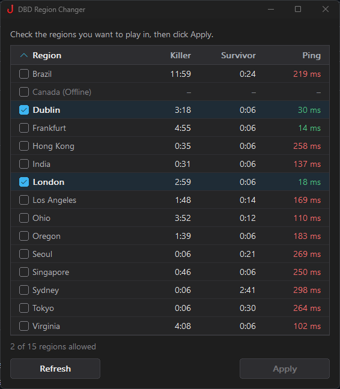

<p align="center"></p>

# DBD Region Changer

A lightweight Windows desktop tool for changing your Dead by Daylight server region.



## Download

Get the latest [DBDRegionChanger.exe](https://github.com/Mu-Ue/DBD-Region-Changer/releases/latest/download/DBDRegionChanger.exe) from the [releases page](https://github.com/Mu-Ue/DBD-Region-Changer/releases).

## Requirements

- Windows 10 or later
- Administrator privileges (required for hosts file modification)

## Building

This project uses the MSVC compiler and requires Visual Studio with the **C++ desktop workload** installed.

```bash
build_msvc.bat
```

The compiled `DBDRegionChanger.exe` will be produced in the project root.

## Usage

1. Run `DBDRegionChanger.exe` as administrator
2. Check the regions you want to play in
3. Click **Apply** to update the hosts file
4. Restart Dead by Daylight for changes to take effect
